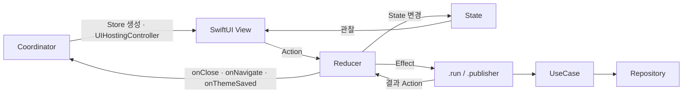
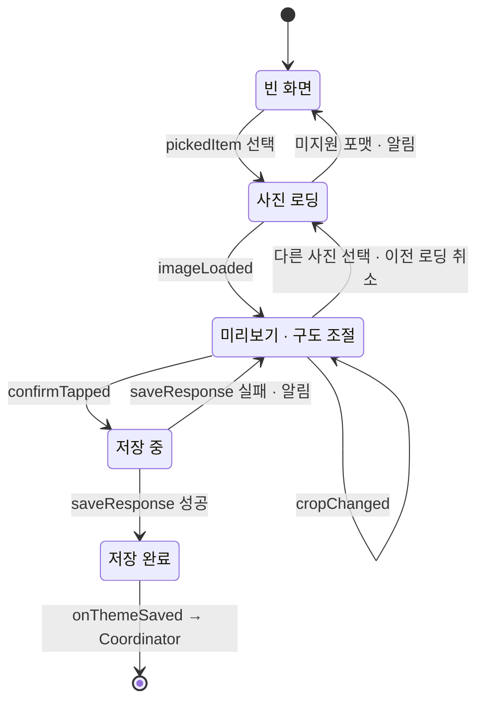
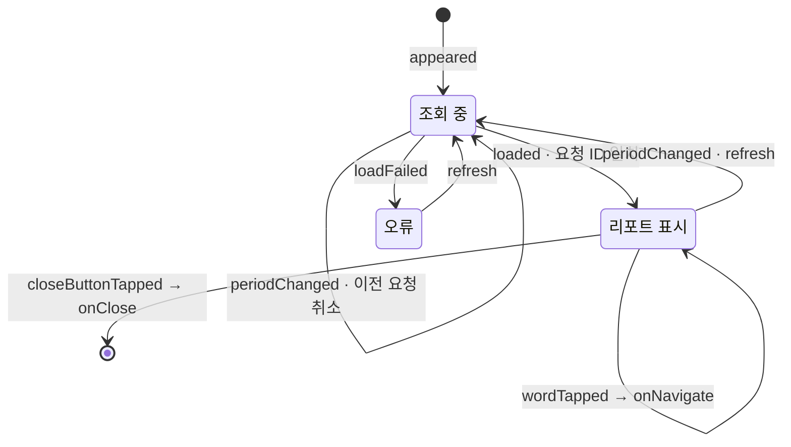
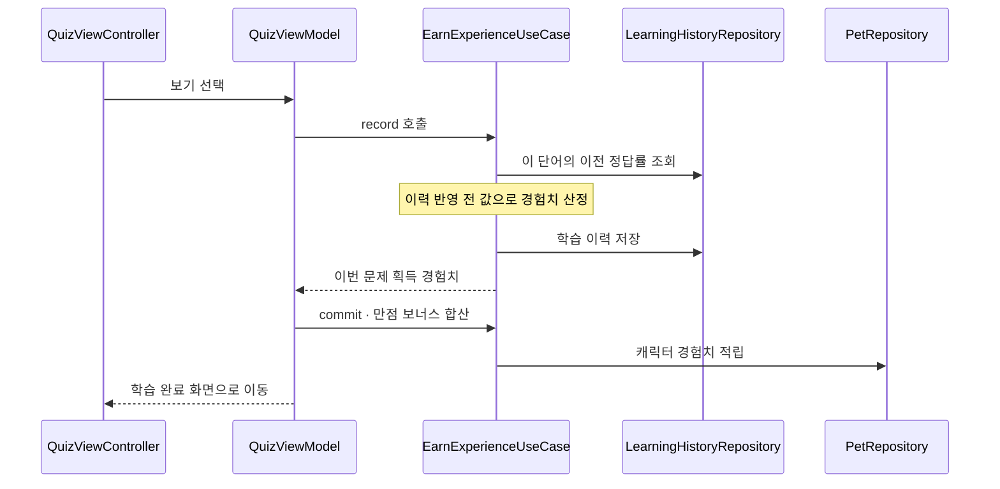
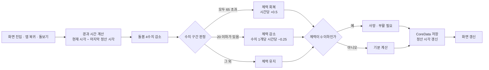
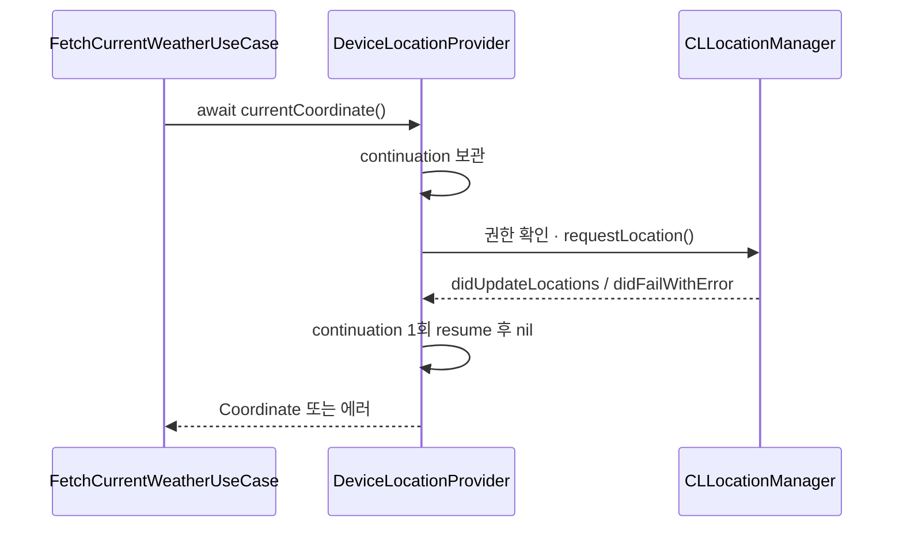
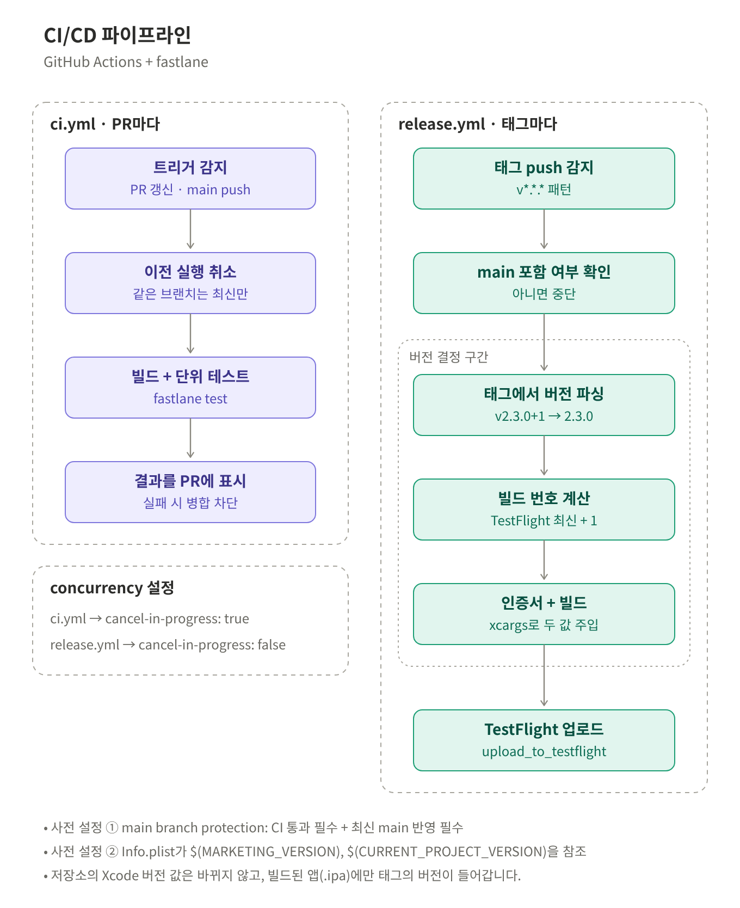

# 단어고치

> 단어고치는 영어학습을 하고 사용자의 성장을 캐릭터의 성장으로 표현해<br/>
> 학습의 재미와 성장을 직관적으로 보여주는 앱 입니다

**핵심 개발**: 2025.09 ~ 2025.10<br>
**유지보수**: 2025.10 ~ 현재<br>
**개발 인원**: 1인 개발<br>
**최소 지원 버전**: iOS 17.0<br>
**다운로드**: [](https://apps.apple.com/kr/app/%EB%8B%A8%EC%96%B4%EA%B3%A0%EC%B9%98/id6753820016)<br>

## 주요 화면

| 관심사 선택 | 배경 테마 선택 | 알 선택 |
|:---:|:---:|:---:|
|  |  |  |


| 단어 탐색 | 4지선다 퀴즈 | 학습 결과 |
|:---:|:---:|:---:|
|  |  |  |


| 추천 단어장 | 단어 추가 | 단어장 상세 |
|:---:|:---:|:---:|
|  |  |  |

<table>
  <thead>
    <tr>
      <th align="center">캐릭터 화면</th>
    </tr>
  </thead>
  <tbody>
    <tr>
      <td align="center">
        
      </td>
    </tr>
  </tbody>
</table>

## 주요 기능

### 온보딩 (Onboarding)

* 관심 주제 선택으로 첫 학습 단어장 지정
* Unsplash API 기반 배경 사진 검색
* 스크롤 페이지네이션 · 워터폴 레이아웃 사진 목록
* 사진첩 사진 선택(PhotosPicker) 및 구도 자르기
* 선택한 배경 이미지 로컬 저장 (오프라인에서도 유지)
* 알 선택 및 캐릭터 이름 입력 검증 (최대 10자)

### 단어 탐색 (Explore)

* 쇼츠 형태의 세로 페이징 무한 스크롤
* TTS 발음 재생 (AVSpeechSynthesizer)
* 단어별 학습 횟수 · 정답률 표시
* SwiftUI 기반 단어 카드 UI

### 4지선다 퀴즈 (Quiz)

* 학습 횟수 기반 출제 단어 선정 (P2C 알고리즘)
* 학습중 단어장 전체에서 오답 보기 구성
* 진행률 표시 및 정답 · 오답 즉시 피드백

### 학습 결과 (Result)

* 정답 · 오답 수와 획득 경험치 요약
* 전 문제 정답 시 보너스 경험치
* 틀린 문제만 다시 풀기 / 이어서 학습하기

### 단어장 (Library)

* 여행 · 비즈니스 · 감정 · 일상 추천 단어장
* Core Data 기반 나만의 단어 추가 · 수정 · 삭제
* 추천 단어 저장 토글 (`sourceWordId`로 원본 연결)
* 학습중 단어장 전환 (앱 전체에 항상 1개)

### 캐릭터 육성 (Character)

* 포만감 · 갈증 · 즐거움 · 청결 4가지 돌보기
* 돌봄 수치 기반 기분 9종 표시
* 체력(HP) 관리, 사망 및 부활
* 학습 경험치로 레벨업 (최대 Lv.7)
* 앱 종료 중 흐른 시간 일괄 정산
* 스프라이트 시트 기반 픽셀 아트 애니메이션

### 날씨 배경 (Weather)

* CoreLocation 현재 위치 + OpenWeatherMap 현재 날씨 조회
* 날씨 7종(맑음 · 구름 · 비 · 이슬비 · 눈 · 뇌우 · 안개)별 스프라이트 애니메이션
* 위치 거부 · 네트워크 실패 시 기본 배경 유지
* 화면 진입 · 앱 복귀 시 갱신, 중복 요청 방지

### 학습 리포트 (Report)

* 누적 학습 단어 · 정답률 · 연속 학습일 요약
* Swift Charts 막대 · 선 · 원형 그래프
* 최근 7일 / 이번 달 / 전체 기간별 분석
* 학습량 · 회차별 정답률 · 품사 · 주제 비중 · 오답 유형
* TCA 기반 상태 관리

### 설정 (Setting)

* 로컬 알림 학습 리마인더 (아침 · 저녁, 미학습 알림)
* 화면 모드 선택: 시스템 · 라이트 · 다크 (v2.3.0)
* 배경 테마 변경 (검색 · 사진첩)
* 메일 문의(MessageUI) · 앱스토어 리뷰 · 개인정보 처리방침(SafariServices)

### 다국어 (Localization)

* String Catalog 기반 한국어 · 일본어 지원 (v2.3.0)
* 앱 언어에 맞춘 일본어 뜻 추천 단어장 (v2.3.0)
* 일본어 폰트 및 텍스트 길이 대응 (v2.3.0)

---

## 아키텍처

### Clean Architecture + MVVM-C


### 디렉토리

```
Danogotchi/
├── App/           앱 진입점 · AppDIContainer + 기능별 DIContainer · Coordinator 계층
├── Core/          BaseViewController · CoreDataStack · 네트워크 · AppLogger
├── Shared/
│   ├── Domain/    Entity · Repository 프로토콜 · UseCase · Policy
│   ├── Data/      Repository 구현 7종 · Mapper · CoreData 모델 · 추천 단어 시드
│   └── DesignSystem/  색 · 폰트 · 여백 토큰과 공통 컴포넌트
└── Feature/       Feature 폴더 13개 (View / ViewModel 또는 Reducer / Components / Coordinator)
```

### TCA

SwiftUI 화면(사진 테마 · 학습 리포트)에만 적용, 화면 전환은 기존 Coordinator가 담당

#### 데이터 흐름



* View는 Action만 보내고 State만 읽음
* 비동기 작업은 Effect에서 실행, 결과는 다시 Action으로 Reducer에 전달
* 화면 이동은 클로저로 Coordinator에 위임

#### 사진 테마 상태 변경 (`PhotoThemeFeature`)



* 로딩·저장 중에는 입력 비활성화
* 저장 실패 시 선택한 사진 유지 후 재시도 가능

#### 학습 리포트 상태 변경 (`StudyReportFeature`)



* 요청마다 ID를 발급해 늦게 도착한 이전 응답 무시
* 앱 복귀·날짜 변경 시 `refresh`로 재조회

## 기술 스택

### 핵심 프레임워크

| 기술 | 용도 |
|---|---|
| Swift 5 · iOS 17.0+ | 개발 언어 · 최소 지원 버전 |
| UIKit | 기존 화면 구성 |
| SwiftUI | 단어 카드 블러, 사진 테마·학습 리포트 화면 |
| RxSwift / RxCocoa 6 | MVVM-C 화면의 Input/Output 바인딩 |
| TCA 1.26 | SwiftUI 화면의 상태 관리 (`@Reducer` · `Store`) |
| Combine | 사진 테마 저장 UseCase ↔ TCA Effect 연결 |
| Swift Concurrency | 네트워크·리포트 조회 비동기 처리 |

### UI

| 기술 | 용도 |
|---|---|
| SnapKit | 코드 기반 오토레이아웃 |
| DiffableDataSource | 단어 카드·단어장·테마 목록 |
| Swift Charts | 학습 리포트 차트 |
| PhotosUI | 사진첩 사진 선택 (`PhotosPicker`) |
| Toast-Swift | 토스트 메시지 |
| IQKeyboardManager | 키보드 가림 처리 |

### 네트워킹

| 기술 | 용도 |
|---|---|
| URLSession + async/await | API 요청 (`DefaultApiClient`) |
| Router 패턴 (`Endpoint`) | API 요청 정의 |
| Unsplash API | 배경 테마 사진 검색 |
| OpenWeatherMap API | 현재 날씨 조회 |

### 데이터 저장

| 기술 | 용도 |
|---|---|
| Core Data | 단어·단어장·학습 기록·퀴즈 회차·펫 저장 |
| UserDefaults | 사용자 설정·테마 파일명 |
| FileManager | 배경 테마 이미지 로컬 파일 저장 |

### 이미지 처리

| 기술 | 용도 |
|---|---|
| ImageIO | 포맷 판별·다운샘플 디코딩 |
| UIGraphicsImageRenderer | 사진 테마 크롭 합성 |
| NSCache | 테마 검색 썸네일 메모리 캐시 |

### 시스템 연동

| 기술 | 용도 |
|---|---|
| CoreLocation | 날씨 조회용 현재 위치 |
| AVFoundation | 단어 발음 TTS |
| UserNotifications | 학습 알림 예약 |
| MessageUI · SafariServices | 문의 메일 · 웹 페이지 열기 |
| String Catalog | 한국어·일본어 현지화 (`Localizable.xcstrings`) |

### 모니터링 · 푸시

| 기술 | 용도 |
|---|---|
| Firebase Crashlytics | 크래시·비정상 오류 수집 |
| Firebase Cloud Messaging | 원격 푸시 알림 |
| OSLog (`AppLogger`) | 카테고리별 로그 |

### 테스트 · 빌드 · 배포

| 기술 | 용도 |
|---|---|
| XCTest | 단위 테스트 |
| XCUITest | 온보딩·퀴즈·캐릭터·단어장·설정·사진 테마·학습 리포트 UI 테스트 |
| TCA `TestStore` | Reducer 상태 변화 검증 |
| Swift Package Manager | 의존성 관리 |
| xcconfig | 개발·운영 스킴 분리 |
| SwiftLint | 빌드 시 코드 규칙 검사 (SPM 빌드 플러그인) |
| GitHub Actions | PR 단위 테스트 · 태그 push 배포 자동화 |
| fastlane | 테스트 실행 · `match` 인증서 관리 · TestFlight 업로드 |

## 주요 아키텍처 결정 사항

1. **Clean Architecture + MVVM-C**: Domain이 UI·저장소를 모르게 분리하고, 화면 전환은 Coordinator가 전담
2. **Input/Output 단일 진입점**: 모든 ViewModel이 `transform(input:) -> Output`을 구현, Output은 `Driver`·`Signal`로 노출해 메인 스레드 보장
3. **화면 단위 TCA 점진 도입**: 신규 SwiftUI 화면만 TCA로 만들고 기존 UIKit 화면은 MVVM-C 유지, 이동 목적지는 Coordinator가 결정
4. **Rx ↔ async 경계를 ViewModel에 고정**: Domain·Data는 RxSwift 없이 `throws`·`async`·`AsyncStream`만 노출
5. **Core Data 쓰기는 동기 `throws` 유지**: 저장 성공 이후에만 변경 신호를 방출하는 불변식 보장, 실패는 롤백 후 화면에 전달
6. **UseCase는 저장소 접근이 있을 때만**: 상태 없는 규칙은 `PetStatePolicy` 같은 Policy로 분리해 형식적인 UseCase 지양
7. **싱글턴 제거 + 기능별 DI 컨테이너 (v2.3.0)**: 상태를 가진 리포지토리만 앱 스코프로 공유, Coordinator는 자기 기능 컨테이너만 수신
8. **타이머 없는 경과 시간 정산**: 백그라운드 작업 없이 화면 진입·앱 복귀 시점에 마지막 정산 이후 시간을 한 번에 계산
9. **외부 이미지 라이브러리 제거**: 내려받는 크기·포맷·디코딩 시점을 직접 제어해 전송량과 메모리 절감
10. **새 파일 저장 후 이전 파일 정리**: 다운로드·저장이 실패해도 기존 배경 보존
11. **시간·랜덤 값 주입**: `now`·`Calendar`·`RandomNumberGenerator`를 매개변수로 받아 테스트 결과 고정
12. **태그 기반 CI/CD (v2.3.0)**: PR마다 단위 테스트, `v*.*.*` 태그 push로 TestFlight 자동 배포

## 데이터 흐름

### 퀴즈 정답 → 경험치 적립



### 캐릭터 상태 정산

화면을 열거나 앱으로 돌아온 순간, 마지막 정산 시각과의 차이를 계산해 한 번에 반영후 저장



## 핵심 구현

### 1. P2C 토너먼트 퀴즈 출제

덜 공부한 단어를 우선 출제하면서도 매번 다른 문제 세트를 만드는 선택 알고리즘입니다.

```swift
static func selectByTournament<G: RandomNumberGenerator>(
    from vocabs: [Vocab],
    stats: [UUID: LearningStats],
    limit: Int,
    using generator: inout G
) -> [Vocab] {
    var candidates = vocabs
    var selected: [Vocab] = []

    while selected.count < limit, candidates.count >= 2 {
        // 서로 다른 두 후보 인덱스를 뽑는다
        let firstIndex = Int.random(in: 0..<candidates.count, using: &generator)
        var secondIndex = Int.random(in: 0..<(candidates.count - 1), using: &generator)
        if secondIndex >= firstIndex { secondIndex += 1 }

        // 이력 없는 신규 단어는 학습횟수 0으로 취급되어 항상 우선 채택된다
        let firstTotal = stats[candidates[firstIndex].id]?.total ?? 0
        let secondTotal = stats[candidates[secondIndex].id]?.total ?? 0

        let winnerIndex: Int
        if firstTotal != secondTotal {
            winnerIndex = firstTotal < secondTotal ? firstIndex : secondIndex
        } else {
            winnerIndex = Bool.random(using: &generator) ? firstIndex : secondIndex
        }
        selected.append(candidates.remove(at: winnerIndex))
    }

    // 학습횟수가 낮은 단어가 앞쪽에 몰리는 채택 순서 편향을 제거한다
    return selected.shuffled(using: &generator)
}
```

**핵심 포인트**

* 랜덤 후보 2개 중 학습 횟수가 적은 단어 채택 (Power of Two Choices)
* 전수 정렬 없이 출제 수(20개)만큼만 뽑아 O(n) 선정
* 단어가 20개 이하면 전체를 섞어 출제, 오답 보기는 항상 단어장 전체에서 구성
* `RandomNumberGenerator`를 주입받아 테스트에서 결과 고정

### 2. 캐릭터 상태 구간 정산

타이머 없이 마지막 정산 시각과의 차이만으로 앱을 꺼둔 시간까지 정산합니다.

```swift
/// 모든 액션이 가장 먼저 부르는 정산 진입점
static func settle(_ pet: Pet, now: Date) -> Pet {
    var settled = pet
    settled.stateUpdatedAt = now

    let elapsedHours = now.timeIntervalSince(pet.stateUpdatedAt) / 3600
    // 기기 시각을 미래로 옮겼다 원복한 경우 타임스탬프만 재동기화
    guard elapsedHours > 0 else { return settled }

    // 사망 후에는 자동 회복하지 않는다
    if !pet.isDead {
        settled.hp = settledHP(pet, elapsedHours: elapsedHours)
    }
    for stat in PetCareStat.allCases {
        settled[keyPath: stat.keyPath] = decayed(pet, stat, elapsedHours)
    }
    return settled
}

/// 각 수치가 임계값을 통과한 시각으로 구간을 쪼개 회복·정지·감소를 시간순으로 적용
private static func settledHP(_ pet: Pet, elapsedHours: Double) -> Double {
    var hp = pet.hp
    let points = boundaries(pet, elapsedHours: elapsedHours)

    for (start, end) in zip(points, points.dropFirst()) {
        // 구간 안에서는 어떤 수치도 임계값을 넘지 않으므로 중간값으로 변화율 결정
        let rate = hpChangePerHour(pet, at: (start + end) / 2)
        hp = min(maxHP, max(0, hp + rate * (end - start)))
        if hp <= 0 { return 0 }
    }
    return hp
}
```

**핵심 포인트**

* 화면 진입·앱 복귀·돌보기 시점에만 호출, 백그라운드 타이머 없음
* 수치가 임계값(65·20)을 지나는 시각으로 구간을 나눠, 회복 구간이 감소로 뒤집히지 않게 계산
* 구간마다 체력 상·하한을 적용해 상한에 막힌 회복분이 피해를 상쇄하지 않음
* 밸런스 상수는 `PetStatePolicy` 한 파일에 모음
* 전체 흐름은 [캐릭터 상태 정산](#캐릭터-상태-정산) 다이어그램 참고

### 3. 배경 테마 이미지 파이프라인 — Kingfisher 제거 후 직접 구현

다운로드·검증·저장·디코딩 단계를 직접 나눠 크기·포맷·메모리를 제어합니다.

```
Unsplash CDN            w·h = 화면 픽셀, fit=crop, fm=heic → 실패 시 webp
      │
      ▼
ImageDecoder.validate   실제 바이트로 포맷 판별 + 64px 디코딩 확인
      │
      ▼
ImageFileStorage.save   UUID.확장자 · .atomic 쓰기 · 백업 제외
      │
      ▼
UserDefaults            파일명만 저장 → removeAllExcept로 이전 파일 정리
      │
      ▼
ImageDecoder.decode     화면 높이 픽셀까지만 다운샘플 (Task.detached)
```

```swift
/// 순서가 중요하다. 먼저 지우면 다운로드가 실패했을 때 기존 배경까지 잃는다.
func performReplace(rawUrl: String) async throws {
    let (data, fileExtension) = try await fetchImageData(rawUrl: rawUrl)

    let fileName = UUID().uuidString + "." + fileExtension
    try storage.save(data, fileName: fileName)

    userSettings.currentThemeImageFileName = fileName
    userSettings.currentThemeUrl = rawUrl

    // 마지막에 정리한다. 여기서 실패하거나 직전에 앱이 죽어도 다음 저장 때 함께 치워진다.
    storage.removeAllExcept(fileName: fileName)
}

/// HEIC로 먼저 받고, 실패하면 WebP로 한 번 더 시도한다.
func fetchImageData(rawUrl: String) async throws -> (Data, String) {
    var lastError: Error = NetworkError.invalidURL

    for format in Format.allCases {
        // 취소됐으면 다음 포맷을 시도하지 않는다
        try Task.checkCancellation()

        guard let url = makeImageURL(rawUrl: rawUrl, format: format) else {
            lastError = NetworkError.invalidURL
            continue
        }

        do {
            let data = try await apiClient.data(from: url)

            // 상태코드로는 판정할 수 없다 — CDN은 fm 값을 못 알아들어도 200에 다른 포맷을 준다
            guard let fileExtension = ImageDecoder.validate(data) else {
                throw NetworkError.transport(URLError(.cannotDecodeContentData))
            }
            return (data, fileExtension)
        } catch {
            lastError = error
        }
    }

    throw lastError
}
```

**핵심 포인트**

* **Before**: Kingfisher가 원본 해상도를 받아 디코딩, 크기·포맷·디코딩 시점을 제어할 지점이 없음
* **After**: `URLSession` · `ImageIO` · `ImageFileStorage`로 직접 구현, 외부 이미지 라이브러리 의존성 제거
* 서버에서 화면 크기로 센터 크롭해 받아 전송량·디코딩 메모리 감소, 업스케일 없음
* UserDefaults에는 파일명만 저장해 재설치·복원으로 경로가 바뀌어도 탐색, 파일이 사라지면 원본 URL로 재다운로드
* 내 사진 테마도 같은 저장 경로 재사용 — 0...1 정규화 크롭 좌표(`PhotoThemeCrop`)로 미리보기와 결과 일치, `ThemeImageRenderer`가 화면 픽셀 크기로 합성
* 검색 그리드 썸네일은 `RemoteImageLoader`(URLSession + NSCache) 메모리 캐시, 셀 재사용 시 요청 취소

### 4. AsyncBroadcaster — 하나의 변경을 여러 화면에 전달

구독마다 새 `AsyncStream`을 만들어 같은 변경 신호를 모든 화면에 보냅니다.

```swift
/// 구독마다 새 AsyncStream을 만들어 같은 값을 모두에게 보낸다
final class AsyncBroadcaster<Element: Sendable>: @unchecked Sendable {
    private let lock = NSLock()
    private var continuations: [UUID: AsyncStream<Element>.Continuation] = [:]

    /// current가 있으면 구독 즉시 현재 값을 먼저 보낸다
    func stream(current: (() -> Element)? = nil) -> AsyncStream<Element> {
        let (stream, continuation) = AsyncStream.makeStream(of: Element.self, bufferingPolicy: .bufferingNewest(1))
        let id = UUID()
        continuation.onTermination = { [weak self] _ in
            guard let self else { return }
            self.lock.withLock { _ = self.continuations.removeValue(forKey: id) }
        }
        lock.withLock {
            if let current { continuation.yield(current()) }
            continuations[id] = continuation
        }
        return stream
    }

    func send(_ value: Element) {
        lock.withLock { continuations.values.forEach { $0.yield(value) } }
    }
}
```

**핵심 포인트**

* `AsyncStream` 하나를 여러 곳에서 순회하면 값이 나뉘므로, 구독마다 continuation을 따로 생성
* `bufferingNewest(1)` — 변경 신호·최신 값 용도라 마지막 값 하나만 유지
* `current`로 구독 즉시 현재 값 전달 (배경 테마 파일명)
* 구독이 끝나면 `onTermination`에서 자동 해제
* ViewModel이 `asObservable()`로 받아 `MainScheduler`에서 바인딩 — Domain·Data는 RxSwift를 모름

### 5. 델리게이트 → async 변환 (CLLocationManager)

델리게이트 기반 위치 조회를 `withCheckedThrowingContinuation`으로 한 번의 `async` 호출로 바꿉니다.

```swift
@MainActor
final class DeviceLocationProvider: NSObject, LocationProviding {
    private var continuation: CheckedContinuation<Coordinate, Error>?

    func currentCoordinate() async throws -> Coordinate {
        guard continuation == nil else { throw LocationError.requestInProgress }

        return try await withCheckedThrowingContinuation { continuation in
            self.continuation = continuation
            requestLocationIfAuthorized(makeManagerIfNeeded())
        }
    }

    private func resume(with result: Result<Coordinate, Error>) {
        guard let continuation else { return }
        self.continuation = nil
        continuation.resume(with: result)
    }
}

extension DeviceLocationProvider: @preconcurrency CLLocationManagerDelegate {
    func locationManager(_ manager: CLLocationManager, didUpdateLocations locations: [CLLocation]) {
        guard let location = locations.last else { return }
        resume(with: .success(
            Coordinate(
                latitude: location.coordinate.latitude,
                longitude: location.coordinate.longitude
            )
        ))
    }

    func locationManager(_ manager: CLLocationManager, didFailWithError error: Error) {
        resume(with: .failure(error))
    }
}
```



**핵심 포인트**

* 진행 중인 요청이 있으면 `requestInProgress`로 거절해 continuation 덮어쓰기 방지
* `resume` 직후 `nil`로 비워 이중 resume 차단
* 권한이 미결정이면 권한 요청 후 `locationManagerDidChangeAuthorization`에서 이어서 조회
* `nonisolated override init()`으로 DI 조립부는 메인 격리 밖에 둠

### 6. 학습 리포트 — 늦게 도착한 응답 무시

기간을 빠르게 바꿔도 마지막 요청 결과만 화면에 반영합니다.

```swift
private func load(_ state: inout State) -> Effect<Action> {
    let id = uuid()
    let period = state.period
    let date = now()
    let calendar = calendar()
    state.loadStatus = .loading(id)
    return .run { send in
        do {
            let report = try await fetch(period, date, calendar)
            try Task.checkCancellation()
            await send(.loaded(id, report))
        } catch is CancellationError {
            return
        } catch {
            guard !Task.isCancelled else { return }
            reportError(error)
            await send(.loadFailed(id))
        }
    }
    .cancellable(id: CancelID.load, cancelInFlight: true)
}

// Reducer
case let .loaded(id, report):
    guard state.loadStatus == .loading(id) else { return .none }
```

**핵심 포인트**

* `.cancellable(id:cancelInFlight: true)`로 새 요청 시작 시 이전 요청 취소
* 요청마다 ID를 발급하고, 현재 상태의 ID와 다른 응답은 무시
* 집계는 background context에서 수행해 메인 스레드 비차단
* 답변마다 회차 ID·문제 번호·단어 스냅샷 저장, `sourceWordId` 기준 집계로 같은 추천 단어 중복 카운트 방지
* Swift Charts(`BarMark` · `LineMark` · `SectorMark`) + 차트 선택 인터랙션

### 7. Core Data ModelV2 마이그레이션

퀴즈 회차·답변 스냅샷을 추가하면서 기존 학습 기록을 잃지 않도록 단계적으로 옮깁니다.

```swift
static func backfillIfNeeded(context: NSManagedObjectContext) throws {
    try context.performAndWait {
        guard let coordinator = context.persistentStoreCoordinator,
              let store = coordinator.persistentStores.first else {
            throw StudyReportDataError.invalidRecord
        }
        let version = coordinator.metadata(for: store)[backfillVersionKey] as? Int ?? 0
        guard version < backfillVersion else { return }

        try backfill(context: context)
        let previousMetadata = coordinator.metadata(for: store)
        var metadata = previousMetadata
        metadata[backfillVersionKey] = backfillVersion
        coordinator.setMetadata(metadata, for: store)
        do {
            // 레코드 변경이 없어도 완료 메타데이터 저장
            try context.save()
        } catch {
            context.rollback()
            coordinator.setMetadata(previousMetadata, for: store)
            throw error
        }
    }
}
```

**핵심 포인트**

* 마이그레이션 전 읽기 전용으로 기존 저장소를 열어 중복 ID 사전 검사, 실패 시 기존 데이터 보존
* 기존 학습 기록에 스냅샷 백필, 완료 여부는 저장소 메타데이터 버전으로 관리
* 백필 저장 실패 시 롤백 후 메타데이터 원복 → 다음 실행에서 재시도
* 답변 저장 시 회차 ID + 문제 번호로 중복 저장 방지

### 8. 싱글턴 제거 + 기능별 DI 컨테이너 (v2.3.0)

전역 싱글턴을 없애고, 앱 스코프 인스턴스와 기능별 조립을 분리했습니다.

```swift
/// 앱 스코프 공유 인스턴스. 기능 컨테이너가 받는 유일한 입력이다.
/// 규칙: 변경 스트림 같은 상태를 가진 리포지토리는 여기서 1개만 공유하고, 무상태 리포지토리는 호출마다 만든다.
struct AppDependencies {
    let screenPixelSize: CGSize
    let coreDataStack: CoreDataStack
    let apiClient: ApiClient
    let speechSynthesizer: SpeechSynthesizing
    /// 테마 파일명 변경 스트림 보유
    let userSettingsRepository: UserSettingsRepository
    /// activeBookChanged 스트림 보유
    let vocabBookRepository: VocabBookRepository
    let petRepository: PetRepository
    /// 표현 계층의 실패 보고. Crashlytics 호출은 조립부에만 둔다
    let reportError: @Sendable (Error) -> Void
    // ...
}

/// quizData는 재시작마다 바뀌므로 컨테이너 스코프가 아니라 팩토리 인자로 받는다
final class QuizDIContainer {
    private let dependencies: AppDependencies

    func makeQuizViewModel(quizData: QuizData) -> QuizViewModel {
        return QuizViewModel(
            earnExperienceUseCase: DefaultEarnExperienceUseCase(
                learningHistoryRepository: dependencies.makeLearningHistoryRepository(),
                petRepository: dependencies.petRepository
            ),
            studyReminderUseCase: dependencies.makeStudyReminderUseCase(),
            quizData: quizData
        )
    }
}
```

```
AppDIContainer ── AppDependencies (앱 스코프 공유)
   ├─ OnboardingDIContainer → OnboardingCoordinator
   ├─ MainDIContainer       → MainCoordinator
   ├─ LibraryDIContainer    → LibraryCoordinator
   ├─ QuizDIContainer       → QuizCoordinator
   └─ SettingDIContainer    → SettingCoordinator
```

**핵심 포인트**

* `CoreDataStack.shared` · `TTSManager` · `UserInfoManager` 싱글턴을 `DatabasePreparing` · `SpeechSynthesizing` · `UserSettingsRepository` 프로토콜 뒤로 이동
* `AppDIContainer`는 `AppDependencies`와 기능 컨테이너 팩토리만 보유, Coordinator는 자기 기능 컨테이너만 수신
* 상태(스트림)를 가진 리포지토리는 1개 공유, 무상태 리포지토리는 호출마다 생성으로 규칙 통일
* 화면 크기(`screenPixelSize`)와 에러 보고(`reportError`)도 주입해 `UIScreen.main`·Crashlytics 직접 호출 제거
* `AppDIContainerTests`로 조립 결과 검증

### 9. 화면 모드 — 시스템·라이트·다크 (v2.3.0)

앱 창 단위로 모드를 적용해 모든 화면과 모달이 함께 바뀝니다.

```swift
final class DefaultAppearanceModeUseCase: AppearanceModeUseCase {
    private let userSettings: UserSettingsRepository
    private let applier: AppearanceApplying

    var current: AppearanceMode {
        return userSettings.appearanceMode
    }

    func set(_ mode: AppearanceMode) {
        userSettings.appearanceMode = mode
        applier.apply(mode)
    }

    func applySaved() {
        applier.apply(userSettings.appearanceMode)
    }
}

/// 앱 창에 모드를 건다 — 창 아래 화면·모달이 모두 따라간다
final class WindowAppearanceApplier: AppearanceApplying {
    private weak var window: UIWindow?

    func apply(_ mode: AppearanceMode) {
        window?.overrideUserInterfaceStyle = mode.userInterfaceStyle
    }
}
```

**핵심 포인트**

* `UIWindow.overrideUserInterfaceStyle` 한 곳에 적용해 화면별 처리 없이 전체 전환
* UseCase는 `AppearanceApplying` 프로토콜에만 의존 → UIKit 없이 단위 테스트
* 앱 시작 시 `applySaved()`로 저장된 모드 복원, 첫 실행은 시스템 설정을 따름
* `AppColor`에 라이트·다크 동적 색 토큰(`surface` · `outline` · `inverse` 등) 추가, 컴포넌트는 의미 토큰만 사용

### 10. 일본어 지원 (v2.3.0)

UI 문구와 함께 추천 단어의 뜻도 앱 언어에 맞춰 제공합니다.

```swift
static func seedIfNeeded(
    context: NSManagedObjectContext,
    language: String? = Bundle.main.preferredLocalizations.first
) throws {
    let request = VocabBookEntity.fetchRequest()
    guard try context.count(for: request) == 0 else { return } // 멱등: 책이 하나라도 있으면 스킵

    // 첫 실행 시 앱 언어로 뜻 선택, 이후 언어를 바꿔도 저장된 뜻은 유지
    let isJapanese = language == "ja"
    let seeds: [(topic: BookTopic, level: VocabLevel?, words: [(String, String, PartOfSpeech)])] = [
        (.myBook, nil, []),
        (.travel, .a1, isJapanese ? MockTravelWordsJa.data : MockTravelWords.data),
        (.business, .a1, isJapanese ? MockBusinessWordsJa.data : MockBusinessWords.data),
        (.emotion, .a1, isJapanese ? MockEmotionWordsJa.data : MockEmotionWords.data),
        (.life, .a1, isJapanese ? MockLifeWordsJa.data : MockLifeWords.data),
    ]
    // ...
}
```

**핵심 포인트**

* String Catalog(`Localizable.xcstrings`)로 한국어·일본어 UI 문구 관리, 일본어 앱 이름·폰트 대응
* 첫 실행 언어로 추천 단어 뜻을 시드하고, 이후 언어를 바꿔도 저장된 뜻은 유지
* 언어를 매개변수로 받아 `DatabaseSeederTests`에서 언어별 시드 검증
* 길어진 일본어 문구에 맞춰 온보딩·테마 화면 레이아웃 대응

### 11. CI/CD 파이프라인 (v2.3.0)



## 테스트

* 정책·UseCase·ViewModel·Coordinator·Reducer·DI 조립·영속화·네트워크·이미지 처리 단위 테스트 **347개**
* 온보딩·단어 탐색·퀴즈·캐릭터·단어장·설정·사진 테마·학습 리포트 흐름 XCUITest **26개**
* PR마다 GitHub Actions에서 단위 테스트 자동 실행

### 테스트 가능한 구조 설계

- Repository·UseCase·`ApiClient`·`LocationProviding`을 **프로토콜로 추상화**하고 **생성자 주입**으로 연결해, 테스트에서 Controlled·Recording 더블로 대체합니다.
- 비즈니스 규칙을 `PetStatePolicy`·`StudyReminderPolicy` 등 정책과 UseCase로 분리해 **UI 없이 로직만 단독으로 검증**합니다. ViewModel은 `transform(input:)`의 Output을, 학습 리포트 Reducer는 TCA `TestStore`로 상태 변화를 검증합니다.
- 시간·랜덤 값은 **매개변수로 주입**합니다.
  - 정책과 리포트 집계는 `now`·`Calendar`를 받아 테스트에서 시각과 타임존을 고정합니다.
  - 퀴즈 출제(`selectByTournament`)는 `RandomNumberGenerator`를 받습니다.
- 외부 자원은 테스트용 구현으로 교체합니다.
  - 네트워크: `URLProtocol` 스텁
  - Core Data: 인메모리 저장소, 저장 실패를 일으키는 `FailingSaveContext`
  - 파일: 임시 디렉터리 `FileManager`

### 테스트 적용 범위

- 모든 코드를 테스트하기보다, **로직이 복잡하거나 사이드 이펙트의 영향 범위가 큰 부분**에 유닛 테스트를 집중했습니다.
  - 상태 전이: 펫 체력 감소·돌보기·사망·부활, 레벨·경험치 정책
  - 데이터 계산: 퀴즈 출제·채점, 학습 리포트 기간별 집계·연속 학습일, 학습 알림 일정
  - 이미지 처리: 크롭 영역 좌표 변환, EXIF 방향 8종, 검은 여백 합성, 업스케일 방지
  - 저장·동기화: 저장 실패 시 롤백·재시도, SQLite 재개방, Core Data 마이그레이션·백필 실패 후 재시도, 테마 이미지 교체 실패 시 기존 파일 보존
  - 비동기 흐름: 검색 응답 순서 보장·이전 요청 취소·페이지 재시도
  - 화면 연결 (v2.3.0): ViewModel Output, Coordinator 화면 전환, DI 조립, 화면 모드 저장·적용
- 단순한 UI 코드나 변경 영향이 작은 코드는 테스트 비용 대비 효과를 고려해 제외했습니다.

### 테스트 원칙

- **일관성 있는 결과**: 시각·타임존을 고정한 입력으로 같은 결과를 보장하고, 비동기 응답 순서는 `actor` 더블로 직접 제어합니다.
- **독립성**: 테스트마다 새 인메모리 저장소와 임시 디렉터리를 만들어 실행 순서에 영향받지 않게 했습니다.
- **사이드 이펙트 격리**: 경험치 적립·알림 예약·테마 저장 같은 외부 상태 변경은 Recording·Controlled 더블로 대체해, 호출 여부와 전달된 값을 검증합니다.

### 테스트 환경

- 프레임워크: XCTest, XCUITest, TCA `TestStore`
- 테스트 대상: Policy, UseCase, ViewModel, Coordinator, Reducer, Repository, ApiClient, 이미지 디코딩·렌더링
- CI: GitHub Actions + fastlane (`fastlane test`)
